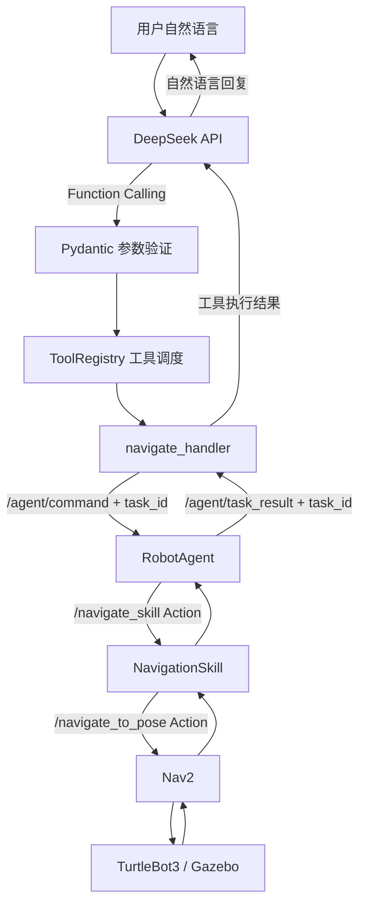

# ROS 2 Robot Agent：基于 DeepSeek 的大模型自主导航机器人

> 一个用于学习和验证 **LLM Agent + ROS 2 + Nav2** 的机器人项目。用户通过自然语言提出需求，DeepSeek 判断是否调用导航工具，Python 负责参数校验与工具调度，ROS 2 负责实际导航，最终再将机器人返回的真实执行结果交给 DeepSeek 生成回复。

项目基于 **ROS 2 Lyrical、Python、TurtleBot3、Gazebo、Nav2 和 DeepSeek API** 开发，目前主要在 Ubuntu 虚拟机的仿真环境中验证。

**当前阶段：** W0 导航系统与基准测试已完成；W1 DeepSeek 工具调用、参数验证、ROS 2 导航闭环已跑通。项目仍属于学习和实验原型，尚未在真实机器人上验证。

## 1. 项目功能

- **自然语言理解**：用户可以输入“我要去厨房”“我要休息了”等中文指令，由 DeepSeek 判断导航目标。
- **Function Calling**：使用 `navigate_to_location` 工具，将模型生成的意图转成结构化参数。
- **参数安全校验**：通过 Pydantic 检查目标地点以及是否出现多余字段，不直接执行未经验证的模型输出。
- **工具注册与调度**：通过 `ToolRegistry` 管理工具名称与对应的 Python 处理函数。
- **ROS 2 导航执行**：经由 RobotAgent、NavigationSkill 和 Nav2 控制 Gazebo 中的 TurtleBot3。
- **任务结果闭环**：通过唯一 `task_id` 匹配导航命令与结果，让 DeepSeek 根据真实 `success` 状态回复。
- **异常结果处理**：处理机器人忙碌、NavigationSkill 不可用以及客户端等待超时等情况。
- **导航基准测试**：保留 W0 的自动化导航测试、成功率和耗时记录。

## 2. 系统架构



**设计原则：大模型负责理解意图和选择工具，不直接操作 Nav2。** 导航请求必须经过本地 Python 校验，并由 ROS 2 节点执行。

一次完整的执行流程为：

1. 用户输入自然语言，DeepSeek 生成工具调用及其参数。
2. `ActionValidator` 校验工具名称、参数结构和目标地点。
3. `ToolRegistry` 调用对应的 `navigate_handler()`。
4. Python 生成本次导航的 `task_id`，通过 `/agent/command` 发送命令。
5. RobotAgent 调用 NavigationSkill，再由 NavigationSkill 调用 Nav2 执行导航。
6. RobotAgent 在 `/agent/task_result` 上发布导航结果。
7. Python 检查返回的 `task_id` 是否匹配，并把实际结果作为 `tool` 消息发回 DeepSeek。
8. DeepSeek 根据真实结果生成最终回复，本次工具任务结束。

## 3. 项目目录

```text
robot_agent_ws/
├── README.md
├── configs/
│   └── nav2_params_tb3.yaml          # Nav2 参数配置
├── src/
│   ├── robot_agent/
│   │   ├── robot_agent/
│   │   │   ├── agent_node.py          # RobotAgent ROS 2 节点
│   │   │   ├── benchmark.py           # W0 自动导航基准测试
│   │   │   ├── agent/
│   │   │   │   ├── action_validator.py # Pydantic 参数校验
│   │   │   │   └── tool_registry.py    # 工具注册与执行
│   │   │   ├── config/
│   │   │   │   └── locations.yaml      # 允许大模型使用的目标地点
│   │   │   └── llm/
│   │   │       └── try_deepseek.py     # DeepSeek 对话及 ROS 2 桥接
│   │   └── test/
│   │       └── test_action_validator.py
│   ├── robot_skills/
│   │   └── robot_skills/
│   │       └── navigate_to_pose.py     # NavigationSkill Action Server
│   └── robot_skills_interfaces/       # 自定义 ROS 2 Action 接口
└── benchmark_result/
    └── benchmark_12_runs.csv          # W0 已保存的测试记录
```

> `build/`、`install/`、`log/`、`.venv-w1/` 等本地生成目录不需要提交到 GitHub。

## 4. 运行环境与依赖

本项目当前开发环境：

| 组件 | 使用情况 |
| --- | --- |
| 操作系统 | Ubuntu（VMware 虚拟机） |
| ROS 2 | Lyrical |
| Python | 3.14 |
| 机器人 | TurtleBot3（Gazebo 仿真） |
| 导航框架 | Nav2 |
| 大语言模型 | DeepSeek API |
| Python 依赖 | `openai`、`pydantic` v2、`PyYAML` 等 |

运行前需要已安装 ROS 2、Nav2、TurtleBot3、Gazebo，以及本项目使用的 `~/nav2_ws` 环境。

### 4.1 构建 ROS 2 工作空间

```bash
source /opt/ros/lyrical/setup.bash
source ~/nav2_ws/install/setup.bash

cd ~/robot_agent_ws
colcon build
source install/setup.bash
```

### 4.2 准备 DeepSeek Python 虚拟环境

如果你已经有可用的 `.venv-w1`，直接激活即可：

```bash
cd ~/robot_agent_ws
source .venv-w1/bin/activate
```

首次搭建环境时，可以考虑让虚拟环境访问 ROS 2 所需的系统 Python 包：

```bash
cd ~/robot_agent_ws
python3 -m venv --system-site-packages .venv-w1
source .venv-w1/bin/activate
python -m pip install openai 'pydantic>=2' PyYAML
```

不同 ROS 2 / Python 安装方式可能还需要 `numpy`、`lark`、`empy` 等依赖。不要覆盖已经配置好的可用虚拟环境。

### 4.3 配置 DeepSeek API Key

```bash
export DEEPSEEK_API_KEY="你的DeepSeek_API_Key"
```

**安全提醒：不要将真实 API Key、`.env` 文件或虚拟环境提交到公开仓库。** `try_deepseek.py` 通过环境变量读取密钥。

## 5. 启动完整导航系统

需要四个终端。每个终端都先加载 ROS 2 环境：

```bash
source /opt/ros/lyrical/setup.bash
source ~/nav2_ws/install/setup.bash
source ~/robot_agent_ws/install/setup.bash
```

### 终端 1：启动 Gazebo、TurtleBot3 和 Nav2

```bash
ros2 launch nav2_bringup tb3_simulation_launch.py \
  params_file:=$HOME/robot_agent_ws/configs/nav2_params_tb3.yaml \
  headless:=False
```

等仿真器及 Nav2 导航服务准备就绪后，再启动后续节点。

### 终端 2：启动 NavigationSkill

```bash
ros2 run robot_skills navigate_to_pose
```

该节点提供 `/navigate_skill` Action Server，并向 Nav2 转发导航目标。

### 终端 3：启动 RobotAgent

```bash
ros2 run robot_agent agent_node
```

RobotAgent 订阅 `/agent/command`，调度 NavigationSkill，并在 `/agent/task_result` 发布任务结果。

### 终端 4：启动 DeepSeek Agent

```bash
cd ~/robot_agent_ws
source .venv-w1/bin/activate
export DEEPSEEK_API_KEY="你的DeepSeek_API_Key"

PYTHONPATH="$PWD/src/robot_agent${PYTHONPATH:+:$PYTHONPATH}" \
python -m robot_agent.llm.try_deepseek
```

这里设置 `PYTHONPATH` 是为了让 Python 能找到源码目录下的 `robot_agent` 包。目前 DeepSeek 程序还没有注册成单独的 `ros2 run` 命令。

## 6. W1 实际运行示例

以下是已经在 Gazebo 仿真中验证过的导航闭环，示例中的耗时来自该次运行：

```text
请输入机器人指令：我要休息了

工具名称：navigate_to_location
原始参数：{"target": "room"}

准备发送 ROS2 指令：go to room
导航指令已发布，等待机器人完成...
收到当前任务的导航结果

工具调用结果：
{
    'target': 'room',
    'success': True,
    'duration_s': 17.97,
    'error_code': 0,
    'agent_retries': 0,
    'task_id': '...'
}

DeepSeek 最终回复：
已经安全到达休息的房间了，好好休息吧。
```

**注意：** 大模型的具体回复、导航时间和任务编号每次可能不同；只有 ROS 2 返回 `success=True` 才能确认该次导航成功。

### 对话交互的预期方式

项目希望实现的交互是：**允许用户先进行任意轮普通对话；一旦模型决定调用导航工具，就执行一次任务，在返回结果后结束本次会话。**

```text
用户：我累了
DeepSeek：需要我带你去房间休息吗？
用户：好，带我过去
DeepSeek：调用 navigate_to_location(target="room")
机器人：执行导航，返回实际结果
DeepSeek：根据结果回复，并结束本次会话
```

这属于预期交互示例，不代表每次输入“我累了”都会触发同样的问答。`tool_choice="auto"` 允许模型根据上下文决定是否调用工具。

## 7. 工具与 ROS 2 通信接口

### 7.1 导航工具

当前提供一个大模型可调用工具：

```text
navigate_to_location(target: string)
```

允许的导航目标来自：

`src/robot_agent/robot_agent/config/locations.yaml`

```yaml
locations:
  - kitchen
  - room
```

目标地点的**实际地图坐标**定义在 `src/robot_skills/robot_skills/navigate_to_pose.py` 中。以后增加地点时，需要同步更新白名单和对应坐标。

### 7.2 Topic 与 Action

| 名称 | 类型 | 作用 |
| --- | --- | --- |
| `/agent/command` | `std_msgs/msg/String` | 向 RobotAgent 发送命令和 `task_id` |
| `/agent/task_result` | `std_msgs/msg/String` | 返回导航结果和 `task_id` |
| `/navigate_skill` | `robot_skills_interfaces/action/NavigateSkill` | RobotAgent 调用 NavigationSkill |
| `/navigate_to_pose` | `nav2_msgs/action/NavigateToPose` | NavigationSkill 调用 Nav2 |

发送给 `/agent/command` 的 `String.data` 可以包含 JSON 字符串：

```json
{"command": "go to kitchen", "task_id": "example-001"}
```

一次任务结果的结构示例：

```json
{
  "target": "kitchen",
  "success": true,
  "duration_s": 17.97,
  "error_code": 0,
  "agent_retries": 0,
  "task_id": "example-001",
  "message": "navigation succeeded"
}
```

`task_id` 由 Python 程序生成，用来区分并匹配 ROS 2 导航任务；DeepSeek Function Calling 中的 `tool_call.id` 则用于对应大模型的工具调用与工具结果，两者用途不同。

### 7.3 不使用 DeepSeek，直接发送导航命令

```bash
ros2 topic pub --once /agent/command \
  std_msgs/msg/String "{data: 'go to kitchen'}"
```

查看任务结果：

```bash
ros2 topic echo /agent/task_result
```

普通手动命令没有 `task_id`，因此主要适合直接测试 ROS 2 导航；LLM 和 benchmark 使用带 `task_id` 的结构化消息。

## 8. W0 导航基准测试

W0 使用自动化脚本完成了 10 次 `kitchen` / `room` 交替导航，以及 2 次故意设置的 `blocked` 目标测试。

```bash
ros2 run robot_agent benchmark
```

历史仿真测试结果：

| 测试指标 | 结果 |
| --- | --- |
| 正常导航任务成功率 | 10 / 10（100%） |
| 正常任务平均耗时 | 14.89 秒 |
| 故意设置的阻塞目标 | 2 / 2 返回错误码 208 |
| 收到最终结果的任务 | 12 / 12 |

测试记录保存在：

```text
benchmark_result/benchmark_12_runs.csv
```

这些数据来自一次小规模仿真测试，不代表大模型工具调用的整体成功率，也不保证未来每次导航都成功。

## 9. 当前限制与待完善事项

1. **跨轮对话记录**：如果代码仍在 `while True` 内重新创建 `messages`，历史对话就会丢失；应在循环外初始化一次，并确保每轮用户消息只追加一次。修改后需要实际验证连续对话场景。
2. **一次会话执行一个导航任务**：当前导航处理逻辑会同步等待任务结果，尚不支持在导航途中同时接收同一个终端的新输入。
3. **Action Goal 被拒绝的回执**：RobotAgent 已加入忙碌拒绝和 NavigationSkill 不可用处理，但 Action Server 主动拒绝 Goal 的分支仍需要向 `/agent/task_result` 发布明确结果。
4. **部署与打包**：LLM 依赖和地点配置目前仍依赖本项目的源码目录与本地环境，尚未制作可独立安装的发行包。
5. **验证范围**：目前验证环境为 Gazebo 仿真，尚未在实体机器人上完成安全评估。

## 10. 开发进度与计划

| 阶段 | 主要内容 | 状态 |
| --- | --- | --- |
| W0 | ROS 2 RobotAgent、NavigationSkill、Nav2 联调与 benchmark | 已完成 |
| W1 | DeepSeek Function Calling、Pydantic、ToolRegistry、真实结果回传 | 核心闭环已验证 |
| W2 | 多工具 Agent、`get_robot_status` 状态查询、更完善的会话与异常处理 | 计划中 |

下一阶段将重点学习如何让大模型在**导航**和**机器人状态查询**等工具之间做出选择，并进一步完善 ROS 2 Agent 的状态管理与错误回执。
